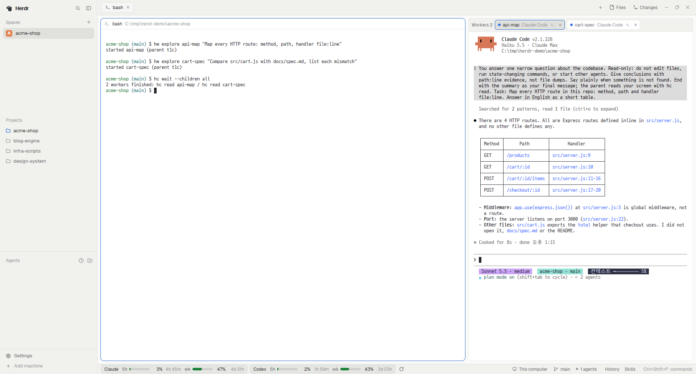
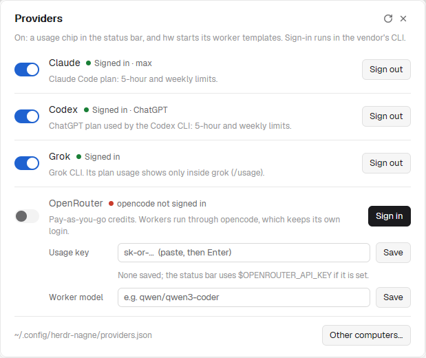
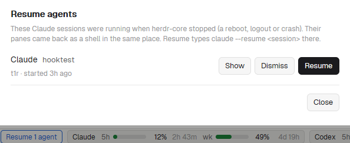

# herdr-nagne-custom

**에이전트 하나를 돌리면서, 그 하위 에이전트들이 일하는 모습을 옆에서 본다.**
[herdr](https://github.com/herdrdev/herdr-app)를 Claude Code·Codex·Grok·OpenRouter 워커 감독용 화면으로 바꾸는 레이아웃 하나, mod 다섯 개, 작은 실행기입니다. Windows에서 매일 쓰며 만들었습니다. macOS 경로도 넣었지만 덜 검증됐습니다.

[English README](README.md) · [프로젝트 지도](MAP.ko.md): 파일 구성, 설치 위치, 연결 구조



*목업이 아닌 실제 화면입니다. 왼쪽 셸에서 `hw`로 읽기 전용 Claude Haiku 워커 두 개를 띄웠습니다. 오른쪽 칸은 워커 화면을 실시간으로 보여줍니다. 왼쪽 아래 사용량 막대는 각 회사의 사용량 조회 주소에서 받은 값입니다.*

## 구성

| 구성 | 하는 일 |
|---|---|
| **`supervisor` 레이아웃** | herdr 기본 레이아웃에 오른쪽 **워커 칸**을 더했습니다. 하위 에이전트가 생기면 저절로 열리고, 모두 끝나면 닫힙니다. `Ctrl+Shift+A`로 켜고 끕니다. |
| **`workers` mod** | 워커 칸 위쪽에 실행 중인 워커마다 칩이 하나씩 붙습니다. 칩을 누르면 그 워커 화면이 아래에 고정됩니다. 칩마다 미리보기와 종료 버튼이 있습니다. |
| **`status-plus` mod** | 기본 상태바에 **프로바이더별 사용량 칸**을 더했습니다. Claude·Codex는 5시간·주간 막대, OpenRouter는 키 잔액, Grok은 CLI가 알려주는 값을 보여줍니다. 어떤 프로바이더를 보일지는 `providers.json`에서 정합니다. 80% 미만은 초록, 80% 이상은 노랑, 90% 이상은 빨강이고, 초기화까지 남은 시간도 보입니다. 새로고침 버튼이 있고, 다시 불러와도 받아 둔 값을 쓰며, 서버가 429(요청 과다)로 답하면 알려준 시간만큼 기다립니다. |
| **`resume` mod + `nagne-session-hook`** | 재부팅·로그아웃·core 비정상 종료 뒤, 칸마다 돌던 Claude Code 세션을 클릭 한 번으로 이어가도록 상태바에 **Resume N agents**를 띄웁니다([재부팅 뒤 이어가기](#재부팅-뒤-이어가기) 참고). |
| **`providers` mod** | **Providers 창**(`Ctrl+Shift+U` 또는 상태바 톱니 버튼). Claude·Codex·Grok·OpenRouter를 켜고 끄고, 각 CLI의 로그인 상태를 보고, **로그인·로그아웃**합니다(로그인은 각 회사 CLI가 herdr 탭에서 진행). OpenRouter 사용량 키와 워커 모델도 여기서 정합니다. |
| **`projects` mod** | 왼쪽에 프로젝트 폴더 목록을 최근 수정 순으로 보여줍니다. 클릭하면 그 폴더에서 작업 중인 Space로 가고, 없으면 새로 엽니다. ×로 목록에서 숨길 수 있고, 디스크의 폴더는 건드리지 않습니다. |
| **`skills` mod** | Claude Code 스킬(개인·프로젝트·플러그인)을 보여주고, `/스킬 인자`를 **대기 중인 에이전트에게만** 보냅니다. |
| **`agent-folders` mod** | Agents 목록을 색깔 폴더로 묶습니다. 끌어다 놓기와 규칙을 지원합니다. [kiote의 mod](https://github.com/kiote/pi-setup/tree/main/herdr/agent-folders)에서 Windows 작업표시줄 점 표시만 뺐습니다. |
| **`hw` + 워커 템플릿** | `hw <템플릿> <이름> "<작업>"`으로 백그라운드 워커를 띄웁니다. 템플릿은 `explore`(Claude Haiku), `grok-explore`(Grok), `openrouter-explore`(opencode로 OpenRouter 모델), `spec-check`·`astra-review`(Codex)이고 모두 읽기 전용입니다. `providers.json`에서 꺼 둔 프로바이더는 실행하지 않습니다. |
| **`scripts/add-machine.sh`** | **Tailscale**로 연결되는 집·회사 컴퓨터를 herdr-core에 추가합니다. 이 창에서 그 컴퓨터의 에이전트를 띄우고 볼 수 있습니다. |

## 설치

### 1. herdr 설치

1. **[herdr.dev](https://herdr.dev)**에서 운영체제에 맞는 설치 파일을 받아 실행합니다. 앱이 **herdr-core**(`hc`)도 함께 설치하고, 이후 업데이트도 알아서 합니다.
2. **새** 터미널을 열고 두 프로그램이 잡히는지 확인합니다.
   ```bash
   herdr-app --version   # 0.1.16에서 검증
   hc --version          # 0.1.21에서 검증
   ```

### 2. 함께 쓰는 도구

| 도구 | 쓰는 곳 | 설치 |
|---|---|---|
| Node.js 18+ | 설치기(`npx`), Codex CLI | [nodejs.org](https://nodejs.org) |
| bash | `hw`, 세션 훅 | Windows: [Git for Windows](https://git-scm.com/download/win)(Git Bash). macOS/Linux: 기본 포함 |
| Claude Code | `explore` 워커, Claude 사용량, Skills 패널 | [설치 안내](https://docs.claude.com/en/docs/claude-code/setup). 설치 후 `claude`를 한 번 실행해 로그인 |
| Codex CLI | `spec-check`·`astra-review` 워커, Codex 사용량 | `npm install -g @openai/codex` 후 `codex login` |
| Grok CLI | `grok-explore` 워커, Grok 칸 | `curl -fsSL https://x.ai/cli/install.sh \| bash` (Windows는 Git Bash) 후 `grok login` |
| opencode | `openrouter-explore` 워커 | `npm install -g @opencode/cli` |
| Tailscale | 다른 컴퓨터 연결(선택) | 두 컴퓨터 모두 [tailscale.com/download](https://tailscale.com/download), 같은 계정으로 로그인 |

쓸 에이전트만 설치하면 됩니다. 로그인하지 않은 서비스는 상태바에 `—`로 표시됩니다.

### 3. kit 설치

아무 터미널(PowerShell, Git Bash, macOS 터미널)에서 실행합니다. Node.js 18 이상이 필요합니다.

```bash
npx github:ggleebwg-stack/herdr-nagne-custom --dry-run   # 추가·교체될 파일을 먼저 보여줌
npx github:ggleebwg-stack/herdr-nagne-custom             # 교체되는 파일은 ~/.herdr-config-backup/<시각>/ 으로 옮겨 둠(삭제 안 함)
```

특정 릴리스를 설치하려면 끝에 `#v0.3.0`을 붙입니다. 저장소를 받을 필요는 없습니다.

설치 스크립트가 복사하는 위치:

| 저장소 | 설치 위치 |
|---|---|
| `mods/*` (mod 7개) | `~/.config/herdr-app/mods/` |
| `layouts/supervisor.json` | `~/.config/herdr-app/layouts/` |
| `templates/*.md` | Windows `%APPDATA%\herdr-core\templates\`, 그 밖 `~/.config/herdr-core/templates/` |
| `hw`, `nagne-session-hook` | `~/.local/bin/` (이 폴더가 PATH에 있어야 함) |
| `providers.example.json` | `~/.config/herdr-nagne/providers.json` (없을 때만) |

사용자의 `keys.json`, `settings.json`, 이미 있는 `providers.json`, `~/.claude/settings.json`은 건드리지 않습니다.

### 4. herdr에서 마무리

1. **단축키**: [`keys.snippet.json`](keys.snippet.json)의 항목을 `~/.config/herdr-app/keys.json`에 옮겨 적습니다. `global`은 기존 `global` 안에 합치고, `layout:supervisor` 구역은 새로 추가합니다.
2. **프로젝트 폴더**: `~/.config/herdr-app/layouts/supervisor.json`에서 `"mod": "projects"`를 찾아 `"root"`를 바꿉니다. 기본값은 `"~/Projects"`입니다. Windows 경로는 `"D:\\Code"`처럼 백슬래시를 두 번 씁니다.
3. **레이아웃**: `Ctrl+Shift+L`을 눌러 **supervisor**로 바꿉니다. 또는 `herdr-app do layout.switch '{"name":"supervisor"}'`를 실행합니다.
4. **재부팅 뒤 이어가기**(선택): [`claude-hooks.snippet.json`](claude-hooks.snippet.json)의 훅 두 개를 `~/.claude/settings.json`에 추가합니다([재부팅 뒤 이어가기](#재부팅-뒤-이어가기) 참고).
5. **프로바이더**: `Ctrl+Shift+U`(또는 사용량 칸 옆 톱니 버튼)로 Providers 창을 열어 켜고 끄고, 필요하면 로그인합니다([프로바이더](#프로바이더) 참고).
6. (선택) `~/.config/herdr-app/settings.json`에서 터미널 글꼴(`"font": "D2Coding"`)이나 worktree 위치(`"worktrees": { "directory": "D:\\Code\\.worktrees" }`)를 정할 수 있습니다. Projects 목록은 점(.)으로 시작하는 폴더를 빼고 보여줍니다.

### 5. 동작 확인

- 상태바 왼쪽 아래에 **Claude**, **Codex** 사용량 칸이 보이는지 확인합니다. `—`는 그 CLI에 로그인하지 않았다는 뜻이고, 마우스를 올리면 이유가 나옵니다.
- 인자 없이 `hw`를 실행하면 템플릿 목록이 나옵니다.
- herdr 안의 터미널에서 `hw explore hello "List the top-level folders here"`를 실행합니다. 오른쪽에 워커 칸이 열리고 워커 화면이 실시간으로 보입니다. 새 폴더를 처음 열면 Claude가 폴더를 신뢰하느냐고 묻는데, 워커 화면에서 한 번만 답하면 됩니다.

### 업데이트와 삭제

- **업데이트**: 같은 `npx` 명령을 다시 실행합니다. 이전 파일은 `~/.herdr-config-backup/<시각>/`에 남습니다.
- **삭제**: `Ctrl+Shift+L`로 `main` 레이아웃으로 돌아갑니다. `~/.config/herdr-app/`에서 `mods/workers`, `mods/projects`, `mods/status-plus`, `mods/providers`, `mods/resume`, `mods/skills`, `mods/agent-folders`, `layouts/supervisor.json`을 다른 곳으로 옮기고, 추가한 단축키를 지웁니다. 화면이 깨지면 `Ctrl+Alt+Shift+Esc`로 herdr 기본 레이아웃으로 초기화할 수 있습니다.

### 문제 해결

| 증상 | 원인과 해결 |
|---|---|
| `hc run <템플릿>`이 `sh`를 못 찾음 (Windows) | herdr-core의 알려진 제약입니다. `hw <템플릿> …`을 쓰세요. |
| `hw`가 `no template`라고 함 | Windows 템플릿 위치는 `%APPDATA%\herdr-core\templates`입니다. `npx` 설치를 다시 실행하세요. |
| 사용량 칸이 `—` | 마우스를 올려 이유를 보세요. `not logged in`은 해당 CLI에 로그인하면 되고, `rate limited`는 서버가 기다리라고 한 것이라 시간이 지나면 저절로 다시 조회합니다. |
| 워커가 **blocked**에 멈춤 | 확인 질문(주로 폴더 신뢰)을 기다리는 중입니다. 워커 칩을 눌러 워커 화면에서 답하세요. |
| mod 자리에 오류 상자가 뜸 | `herdr-app check ~/.config/herdr-app/mods/<이름>`을 실행하면 원인이 나옵니다. |

## 워커 감독

```bash
# herdr 안의 아무 터미널에서
hw explore api-map   "Map every HTTP route: method, path, handler file:line"
hw explore cart-spec "Compare src/cart.js with docs/spec.md, list each mismatch"
hc wait --children all        # 모든 워커가 끝날 때까지 대기
hc read --lines 60 cart-spec  # 워커의 마지막 요약 읽기
```

### 결과는 어디로 가나

워커는 `hw`를 실행한 터미널을 **부모**로 둔 평범한 herdr-core 터미널입니다. 결과를 따로 복사해 두지 않고, 워커 화면과 세션 자체가 결과입니다.

| 단계 | 방법 |
|---|---|
| 진행 보기 | 오른쪽 워커 칸에서 고른 워커 화면을 실시간으로 봅니다. `hc ls`는 모든 워커와 상태(`working`, `blocked`, `done`, `idle`)를 보여줍니다. |
| 끝날 때까지 기다리기 | `hc wait --children all`(또는 `hc wait <이름>`)은 워커가 작업을 멈추면 돌아옵니다. |
| 답 가져오기 | `hc read --lines 60 <이름>`은 마지막 화면을 출력합니다. 템플릿이 마지막에 요약을 남기라고 지시하므로, 마지막 화면이 곧 답입니다. |
| 이어서 묻기 | `hc send <이름> "…"`은 같은 세션에 입력하고, 워커는 앞의 맥락을 그대로 기억합니다. |
| 파일로 남기기 | `hc read --lines 200 <이름> > notes/<이름>.md`처럼 저장합니다. |
| 정리 | `hc kill <이름>`으로 끝내면 칸과 칩도 사라집니다. |

대화 기록은 각 CLI가 평소처럼 따로 남깁니다(Claude Code는 `~/.claude/projects`, Codex는 `~/.codex/sessions`, Grok은 `~/.grok/sessions`). 그래서 워커 세션도 나중에 다른 세션처럼 이어서 쓸 수 있습니다.

## 프로바이더

`Ctrl+Shift+U` 또는 사용량 칸 옆 톱니 버튼으로 **Providers 창**을 엽니다. 창에서 바꾼 내용은 `~/.config/herdr-nagne/providers.json`에 저장되고, 상태바는 1초 안에 따라 바뀝니다.



- **스위치**: 켜면 상태바에 사용량 칸이 생기고, `hw`가 그 프로바이더의 워커 템플릿을 실행합니다.
- **Sign in / Sign out**: 각 CLI의 로그인 여부를 보여줍니다(Claude는 요금제도 표시). **Sign in**을 누르면 herdr 탭에서 각 회사 CLI의 로그인(`claude auth login`, `codex login`, `grok login`, `opencode auth login openrouter`)이 열리고, 끝나면 창이 알아서 갱신됩니다. **Sign out**은 한 번 더 눌러야 실행됩니다. 비밀번호나 토큰은 창을 거치지 않습니다.
- **OpenRouter 사용량 키**: `~/.config/herdr-nagne/openrouter.key`에 저장되고 상태바만 씁니다. **Worker model**은 `"env": { "OPENROUTER_MODEL": "…" }`로 저장되며, 셸에 그 변수가 없을 때 `hw`가 씁니다.
- **Other computers…**는 herdr 설정의 Machines 화면을 엽니다.

파일은 프로바이더 하나를 한 줄에 쓰므로 직접 고쳐도 됩니다.

```json
{
  "claude":     { "enabled": true },
  "codex":      { "enabled": true },
  "grok":       { "enabled": true },
  "openrouter": { "enabled": false, "keyEnv": "OPENROUTER_API_KEY" }
}
```

| 프로바이더 | 상태바 | 쓰는 로그인 | 워커 템플릿 |
|---|---|---|---|
| Claude | 5시간·주간 막대 | Claude Code 로그인 | `explore` |
| Codex | 5시간·주간 막대 | Codex CLI 로그인 | `spec-check`, `astra-review` |
| Grok | `grok usage`가 값을 주면 표시, 아니면 `/usage` 안내(그때는 grok 안에서만 구독 사용량을 볼 수 있음) | Grok CLI 로그인(`grok login`) | `grok-explore` (plan 모드) |
| OpenRouter | 키 잔액(한도가 있으면 막대와 `$ left`, 없으면 `$ used`) | 상태바: `keyFile`의 파일, 없으면 `keyEnv`의 환경변수. 워커: opencode 자체 로그인(`opencode auth login openrouter`) | `openrouter-explore` (opencode, plan 에이전트). 모델은 `OPENROUTER_MODEL` 또는 창의 Worker model(예: `qwen/qwen3-coder`) |

키는 필요할 때 읽고, 기록하지 않으며, 사용자가 넣은 곳(사용량 키 파일)에만 저장합니다. Windows에서는 herdr를 켠 뒤에 설정한 환경변수도 찾습니다. mod가 사용자 환경변수 저장값까지 읽기 때문입니다. 워커는 herdr-core가 띄우므로 내 셸의 환경변수를 물려받지 않습니다. 그래서 OpenRouter 워커는 `OPENROUTER_API_KEY`가 아니라 opencode 자체 로그인을 씁니다.

## 재부팅 뒤 이어가기

herdr 창을 닫아도 아무것도 멈추지 않습니다. herdr-core가 모든 터미널과 에이전트를 계속 돌리고, 창을 다시 열면 그대로 보입니다. 재부팅, 로그아웃, core 비정상 종료는 다릅니다. Space, 탭, 분할 배치는 돌아오지만, 각 칸은 마지막 폴더의 빈 셸로 열립니다. herdr는 프로그램을 스스로 다시 실행하지 않기 때문입니다.

이 kit는 어느 칸에서 어떤 Claude Code 세션이 돌았는지 기억해 두었다가, 이어서 실행할지 묻습니다.



1. **기록**: `nagne-session-hook`이 Claude Code의 SessionStart·SessionEnd 때 `~/.config/herdr-nagne/sessions/<터미널>.jsonl`에 한 줄씩 덧붙입니다. [`claude-hooks.snippet.json`](claude-hooks.snippet.json)의 두 항목을 `~/.claude/settings.json`에 한 번 추가하면 됩니다. 이미 있는 훅은 그대로 두고 옆에 덧붙입니다. herdr 터미널 안의 세션만 기록하고, 칸 안에서 `claude -p`를 따로 실행해도 그 칸의 세션 기록은 덮어쓰지 않습니다.
2. **찾기**: status-plus가 아래 조건을 모두 만족하는 칸을 찾습니다. 앱을 켤 때, 기록이 바뀔 때, 30초마다 확인합니다. herdr-core에 직접 묻기 때문에, 창이 아직 연결 중이어도 돌고 있는 에이전트를 끊긴 것으로 잘못 보지 않습니다.
   - 시작 기록은 있는데 종료 기록이 없다.
   - 그 칸이 아직 있다.
   - 워커가 아니다.
   - 지금 빈 셸이다.
3. **제안**: 상태바 왼쪽에 **Resume N agents** 칸이 생기고 알림이 한 번 뜹니다. 누르면 목록이 열리고, 세션마다 폴더, Space, 시작 시각과 **Show**, **Dismiss**, **Resume** 버튼이 있습니다.
4. **이어가기**: 그 칸을 한 번 더 확인한 뒤 `claude --resume <세션>`을 입력합니다. 칸의 폴더가 다르면 세션 폴더로 먼저 이동합니다. 버튼을 누르기 전에는 아무것도 실행하지 않으므로, 모르는 사이에 사용량이 쓰이지 않습니다.

지금은 Claude Code만 지원합니다.
- Codex: SessionEnd 훅이 없고, 새 훅마다 신뢰 승인이 필요해서 다음 단계로 미뤘습니다.
- Grok: Claude 훅을 같이 읽지만, 스크립트가 Grok 세션은 기록하지 않습니다.
- 다른 컴퓨터: 이 컴퓨터의 칸만 대상입니다.

## Tailscale로 다른 컴퓨터 연결

herdr-core는 ssh로 다른 컴퓨터에서 에이전트를 실행하고 이 창에 보여줄 수 있습니다. 두 컴퓨터에 [Tailscale](https://tailscale.com)을 켜 두면 포트를 열지 않고도 집과 회사가 서로 연결됩니다.

1. **연결할 컴퓨터에서**:
   - Tailscale을 설치하고 같은 계정으로 로그인합니다.
   - ssh를 켭니다. macOS는 시스템 설정 › 일반 › 공유 › **원격 로그인**을 켜고, 내 사용자만 허용합니다. Linux는 ssh 서버를 실행합니다.
2. **이 컴퓨터에서**: 이 저장소를 받은 폴더(`git clone https://github.com/ggleebwg-stack/herdr-nagne-custom`)에서 Git Bash나 macOS 터미널로 `scripts/add-machine.sh home-mac <tailscale 이름> <사용자>`를 실행합니다. tailscale 이름은 `tailscale status`에 나오는 이름이나 `100.x` 주소입니다. 스크립트가 하는 일:
   - ssh 키가 있는지 확인합니다.
   - `~/.ssh/config`에 접속 항목을 추가합니다. 기존 파일은 `~/.ssh/config.bak-<시각>`으로 복사해 둡니다.
   - 로그인을 시험합니다. 실패하면, 이 컴퓨터의 공개키를 상대 컴퓨터의 `~/.ssh/authorized_keys`에 넣는 명령을 그대로 출력합니다.
   - `hc machine add`를 실행합니다. 상대 컴퓨터에 herdr-core가 없으면 설치할지 묻습니다.
3. **사용**: herdr에서 그 컴퓨터로 새 Space를 열거나, 아무 터미널에서 `hc run --on home-mac -- claude`를 실행합니다. 그 컴퓨터의 터미널은 `home-mac/t7`처럼 부르고, `hc read home-mac/t7`도 로컬처럼 동작합니다.

`hc machine ls`로 추가한 컴퓨터를 보고, `hc machine rm <이름>`으로 목록에서 뺍니다. 빼더라도 그 컴퓨터의 터미널은 계속 돕니다.

## Windows에서 알아둘 점

- herdr-core가 `sh`를 실행하려고 해서 `hc run <템플릿>`이 실패합니다. 그래서 **`hw`가 템플릿을 직접 읽어** 실행합니다.
- 템플릿 위치는 `~/.config`가 아니라 `%APPDATA%\herdr-core\templates`입니다.
- npm으로 설치한 `codex.cmd`는 줄바꿈이 들어간 인자를 거부합니다. 그래서 `hw`가 프롬프트를 한 줄로 바꿉니다.
- Codex 읽기 전용 샌드박스에서는 `hc` 파이프를 열 수 없습니다. 그래서 워커는 마지막에 요약을 남기고, 부모가 `hc wait`와 `hc read`로 가져갑니다.

## 선택: 세션 히스토리

History 버튼과 `Ctrl+Shift+H`는 [plutotw/herdr-main-usage](https://github.com/plutotw/herdr-main-usage)의 `history` mod를 엽니다. 그 저장소에는 라이선스가 없어서 **이 저장소에 포함하지 않았습니다.** 원본에서 직접 설치하면 버튼이 나타납니다. Windows에서 쓰려면 바꿀 점은 [영문 README](README.md#optional-session-history-panel)에 정리해 두었습니다.

## 통신과 개인정보

- `status-plus`는 켜 둔 프로바이더의 사용량 조회 주소에만 접속합니다(Anthropic, OpenAI, OpenRouter). 로그인 정보와 키는 각 회사 서버에만 보내고, 따로 저장하거나 기록하지 않습니다. Grok은 로컬 `grok usage --json`만 실행합니다.
- `nagne-session-hook`과 `resume`은 이 컴퓨터 안에서만 동작합니다. `~/.config/herdr-nagne/sessions/`에 세션 ID, 폴더, 시각만 남기고, `hc ls`·`hc get`·`hc send`만 씁니다. 외부로 보내는 것은 없습니다.
- `providers`는 로컬 명령만 실행합니다. 각 CLI의 상태 확인·로그인·로그아웃(`claude auth status`, `codex login status`, `opencode auth list`)과 `~/.grok/auth.json`에 로그인이 있는지 확인하는 것뿐이며, 직접 보내는 통신은 없습니다.
- 나머지 mod는 네트워크를 쓰지 않습니다.

## 라이선스

Apache License 2.0입니다. 외부 출처와 고지는 [NOTICE](NOTICE)와 [영문 README](README.md#credits-and-license)에 있습니다.
