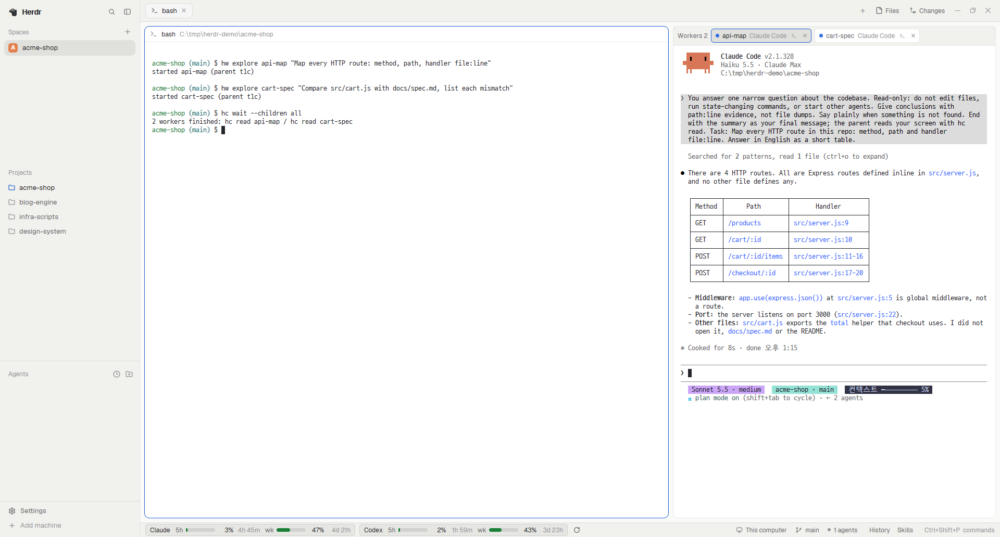
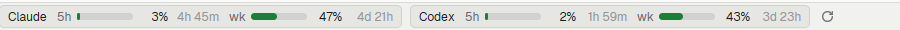
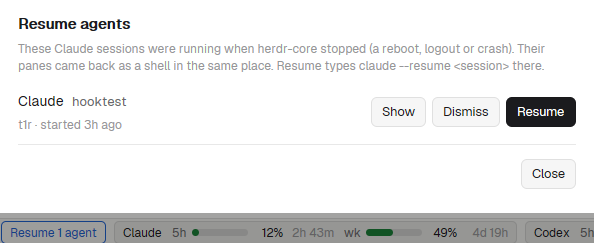

# herdr-nagne-custom

**Run one agent, watch its sub-agents work beside it.**
A layout, five mods and a tiny launcher for [herdr](https://github.com/herdrdev/herdr-app) that turn it into a cockpit for supervising Claude Code, Codex, Grok and OpenRouter workers, on this computer or on another one over Tailscale. Built and used daily on Windows; the macOS paths are written but less tested.

[한국어 README](README.ko.md) · [Project map](MAP.md): every file, where it installs, how the pieces connect



*Real session, not a mock-up. The shell on the left started two read-only Claude Haiku workers with `hw`. The right column follows them live. The usage bars at the bottom left come from the vendors' own usage endpoints.*

---

## What's inside

| | Piece | What it does |
|---|---|---|
| 🧭 | **`supervisor` layout** | herdr's main layout plus a right-hand **worker column**. It opens by itself when a sub-agent starts and closes when the last one ends. `Ctrl+Shift+A` toggles it. |
| 👀 | **`workers` mod** | A chip for each live sub-agent at the top of that column. Click a chip to pin that worker's terminal below it. Each chip also has peek and kill buttons. |
| 📊 | **`status-plus` mod** | herdr's status bar plus a **usage chip per provider**. Claude and Codex show 5-hour and weekly bars, OpenRouter shows the key's credit, and Grok shows what its CLI reports. You choose the providers in `providers.json`. The bars are green below 80%, yellow from 80% and red from 90%, and show when they reset. There is a refresh button, a cache that survives reloads, and 429 back-off. |
| ⏯️ | **`resume` mod + `nagne-session-hook`** | After a reboot, logout or core crash, a **Resume N agents** chip offers to continue the Claude Code sessions that were running in your panes, each with one click (see [Resume after a reboot](#resume-after-a-reboot)). |
| ⚙️ | **`providers` mod** | A **Providers window** (`Ctrl+Shift+U`, or the gear in the status bar): switch Claude, Codex, Grok and OpenRouter on or off, see whether each CLI is signed in, **sign in or out** (the vendor's own login runs in a herdr tab), and set the OpenRouter usage key and worker model. |
| 📁 | **`projects` mod** | A sidebar list of your project folders, newest first. Clicking a folder jumps to the space already working there, or opens one. Hover × hides a folder; nothing on disk is touched. |
| 🧩 | **`skills` mod** | Lists your Claude Code skills (personal, project and plugin) and sends `/skill args` to an agent, **only if that agent is idle**. |
| 🗂️ | **`agent-folders` mod** | The Agents list grouped into colored folders, with drag and drop and rules. This is [kiote's mod](https://github.com/kiote/pi-setup/tree/main/herdr/agent-folders) with the Windows taskbar dot removed. |
| 🚀 | **`hw` + worker templates** | `hw <template> <name> "<task>"` starts a background worker from a template: `explore` (Claude Haiku), `grok-explore` (Grok), `openrouter-explore` (any OpenRouter model via opencode), `spec-check` and `astra-review` (Codex). All of them are read-only. A provider switched off in `providers.json` is refused. |
| 🌐 | **`scripts/add-machine.sh`** | Adds a home or office computer you reach over **Tailscale** to herdr-core, so you can start and watch agents there from this window. |



## Install

### 1. herdr

1. Download the installer for your OS from **[herdr.dev](https://herdr.dev)** and run it. The app installs **herdr-core** (`hc`) with it and keeps both up to date.
2. Open a **new** terminal and check that both are on your PATH:
   ```bash
   herdr-app --version   # tested with 0.1.16
   hc --version          # tested with 0.1.21
   ```

### 2. Tools the kit uses

| Tool | Needed for | Install |
|---|---|---|
| Node.js 18+ | the installer (`npx`), the Codex CLI | [nodejs.org](https://nodejs.org) |
| bash | `hw`, the session hook | Windows: [Git for Windows](https://git-scm.com/download/win) (Git Bash). macOS/Linux: built in |
| Claude Code | `explore` workers, the Claude usage bar, the Skills panel | [docs.claude.com/claude-code](https://docs.claude.com/en/docs/claude-code/setup). Run `claude` once and log in |
| Codex CLI | `spec-check` and `astra-review` workers, the Codex usage bar | `npm install -g @openai/codex`, then `codex login` |
| Grok CLI | `grok-explore` workers, the Grok chip | `curl -fsSL https://x.ai/cli/install.sh \| bash` (Git Bash on Windows), then `grok login` |
| opencode | `openrouter-explore` workers | `npm install -g @opencode/cli` |
| Tailscale | other computers (optional) | [tailscale.com/download](https://tailscale.com/download) on both computers, same account |

You only need the agents you plan to use. A provider that isn't logged in shows `—` in the status bar.

### 3. The kit

Run these in any terminal (PowerShell, Git Bash, macOS Terminal). It needs Node.js 18 or later:

```bash
npx github:ggleebwg-stack/herdr-nagne-custom --dry-run   # prints every file it would add or replace
npx github:ggleebwg-stack/herdr-nagne-custom             # replaced files are moved to ~/.herdr-config-backup/<time>/, never deleted
```

Add `#v0.3.0` to the end to install a given release. There is nothing to clone.

The installer copies:

| From | To |
|---|---|
| `mods/*` (7 mods) | `~/.config/herdr-app/mods/` |
| `layouts/supervisor.json` | `~/.config/herdr-app/layouts/` |
| `templates/*.md` | `%APPDATA%\herdr-core\templates\` on Windows, `~/.config/herdr-core/templates/` elsewhere |
| `hw`, `nagne-session-hook` | `~/.local/bin/`. Make sure `~/.local/bin` is on your PATH |
| `providers.example.json` | `~/.config/herdr-nagne/providers.json`, only if you don't have one yet |

It never touches your `keys.json`, `settings.json`, an existing `providers.json` or `~/.claude/settings.json`.

### 4. Finish in herdr

1. **Keys**: copy the entries in [`keys.snippet.json`](keys.snippet.json) into `~/.config/herdr-app/keys.json` (merge `global` with your existing `global`, and add the `layout:supervisor` section).
2. **Projects folder**: in `~/.config/herdr-app/layouts/supervisor.json`, find `"mod": "projects"` and set `"root"`. The default is `"~/Projects"`. On Windows, write a path like `"D:\\Code"` with doubled backslashes.
3. **Layout**: press `Ctrl+Shift+L` until the **supervisor** layout shows, or run `herdr-app do layout.switch '{"name":"supervisor"}'`.
4. **Resume after a reboot** (optional): add the two hooks in [`claude-hooks.snippet.json`](claude-hooks.snippet.json) to `~/.claude/settings.json` (see [Resume after a reboot](#resume-after-a-reboot)).
5. **Providers**: press `Ctrl+Shift+U` (or the gear next to the usage chips), switch providers on or off, and sign in where needed (see [Providers](#providers)).
6. Optional settings in `~/.config/herdr-app/settings.json`, such as a terminal font (`"font": "D2Coding"`) or where herdr puts worktrees (`"worktrees": { "directory": "D:\\Code\\.worktrees" }`). The Projects list skips dot-folders, so a `.worktrees` folder inside your projects root stays out of it.

### 5. Check it works

- The status bar shows the **Claude** and **Codex** usage chips at the bottom left (`—` means that CLI isn't logged in; hover for the reason).
- `hw` with no arguments lists the templates.
- In a terminal inside herdr, run `hw explore hello "List the top-level folders here"`. The worker column opens on the right with the worker's live screen. The first time Claude opens a new folder, it asks whether you trust it. Answer once in the worker pane.

### Update and uninstall

- **Update**: run the same `npx` line again. Your previous files go to `~/.herdr-config-backup/<time>/`.
- **Uninstall**: switch back to the `main` layout (`Ctrl+Shift+L`), then move these out of `~/.config/herdr-app/`: `mods/workers`, `mods/projects`, `mods/status-plus`, `mods/providers`, `mods/resume`, `mods/skills`, `mods/agent-folders` and `layouts/supervisor.json`. Then remove the keys you added. If the window ever looks broken, `Ctrl+Alt+Shift+Esc` resets it to herdr's default layout.

### Troubleshooting

| Symptom | Cause and fix |
|---|---|
| `hc run <template>` says `sh` not found (Windows) | Known herdr-core limit. Use `hw <template> …` instead. |
| `hw` says `no template` | Templates go to `%APPDATA%\herdr-core\templates` on Windows, not `~/.config`. Run the `npx` install again. |
| A usage chip shows `—` | Hover it. `not logged in` means log in to that CLI. `rate limited` means the vendor asked to wait; the chip retries by itself. |
| A worker sits in **blocked** | It is waiting on a prompt, usually the folder trust question. Click its chip and answer in the worker pane. |
| A mod shows an error box | `herdr-app check ~/.config/herdr-app/mods/<name>` prints what is wrong. |

## Supervising workers

```bash
# from any terminal inside herdr
hw explore api-map   "Map every HTTP route: method, path, handler file:line"
hw explore cart-spec "Compare src/cart.js with docs/spec.md, list each mismatch"

hc wait --children all        # block until every worker finishes its turn
hc read --lines 60 cart-spec  # collect a worker's final summary
```


What the `cart-spec` worker reported in that session:

```
src/cart.js breaks spec rules 2 to 5.
 1  src/cart.js:10     Rule 2  coupon subtracted after tax; must come off the subtotal before tax
 2  src/cart.js:9      Rule 3  tax applied to the raw subtotal, not the discounted one
 3  src/cart.js:11     Rule 4  free-shipping check uses the undiscounted subtotal
 4  src/cart.js:9,12   Rule 5  rounding happens mid-calculation; must round once at the end
```

Templates are Markdown files with `command:` (and optionally `provider:`) front matter and a prompt body. They live in `%APPDATA%\herdr-core\templates\` on Windows and `~/.config/herdr-core/templates/` elsewhere. Copy one to make your own. `${NAME}` in `command:` is filled from the environment, and `hw` refuses to start when it is unset.

### Where the results go

A worker is an ordinary herdr-core terminal whose **parent** is the terminal that ran `hw`. Nothing is copied anywhere. The result is the worker's own screen and session:

| Step | How |
|---|---|
| Watch while it runs | the worker column (`workers` mod) shows the chosen worker's live terminal; `hc ls` lists every worker with its status (`working`, `blocked`, `done`, `idle`) |
| Wait for the end of its turn | `hc wait --children all` (or `hc wait <name>`) returns when the workers stop working |
| Collect the answer | `hc read --lines 60 <name>` prints the last screen. The templates tell every worker to end with its summary, so the last screen is the answer |
| Ask a follow-up | `hc send <name> "…"` types into the same session, and the worker keeps its context |
| Keep it as a file | redirect it: `hc read --lines 200 <name> > notes/<name>.md` |
| Clean up | `hc kill <name>` stops it. Its block leaves the column and the chip disappears |

The agent's own transcript is also kept by its CLI as usual (Claude Code under `~/.claude/projects`, Codex under `~/.codex/sessions`, Grok under `~/.grok/sessions`), so a worker session can be resumed later like any other.

## Providers

Open the **Providers window** with `Ctrl+Shift+U` or the gear next to the usage chips. It edits `~/.config/herdr-nagne/providers.json`, and the status bar follows within a second.


- **Switch**: on = a usage chip in the status bar, and `hw` starts that provider's worker templates.
- **Sign in / Sign out**: shows whether each CLI is signed in (Claude also shows its plan). **Sign in** opens a herdr tab running the vendor's own login (`claude auth login`, `codex login`, `grok login`, `opencode auth login openrouter`), and the window notices when it's done. **Sign out** asks for a second click, then runs the CLI's logout. The window never sees a password or token.
- **OpenRouter usage key**: saved to `~/.config/herdr-nagne/openrouter.key`, for the status bar chip only. **Worker model** is saved as `"env": { "OPENROUTER_MODEL": "…" }`, which `hw` uses when the variable isn't set in your shell.
- **Other computers…** opens herdr's Settings › Machines.

The file keeps one provider per line, so it stays easy to edit by hand too:

```json
{
  "claude":     { "enabled": true },
  "codex":      { "enabled": true },
  "grok":       { "enabled": true },
  "openrouter": { "enabled": false, "keyEnv": "OPENROUTER_API_KEY" }
}
```

| Provider | Status bar | Login it uses | Worker template |
|---|---|---|---|
| Claude | 5h and weekly bars | Claude Code's login (`claude`) | `explore` |
| Codex | 5h and weekly bars | Codex CLI's login (`codex login`) | `spec-check`, `astra-review` |
| Grok | the plan's usage when `grok usage` can report it. Otherwise the chip says `/usage`: Grok then shows plan usage only inside grok | Grok CLI's login (`grok login`) | `grok-explore` (`--permission-mode plan`) |
| OpenRouter | the key's credit: a bar and `$ left` when the key has a limit, else `$ used` | status bar: the file named by `keyFile`, else the variable named by `keyEnv`. Workers: opencode's own login (`opencode auth login openrouter`) | `openrouter-explore` (opencode, plan agent), model from `OPENROUTER_MODEL` or the window's Worker model, e.g. `qwen/qwen3-coder` |

Keys are read when needed, never logged, and written only where you put them (the usage key file). On Windows, a variable you set after herdr started is still found, because the mod also reads your stored user variables. Workers don't inherit your shell's variables (herdr-core starts them), so OpenRouter workers rely on opencode's own login, not on `OPENROUTER_API_KEY`.

## Resume after a reboot

Closing the herdr window never stops anything: herdr-core keeps every terminal and agent running, and reopening the window shows them as they were. A reboot, logout or core crash is different. herdr brings back your spaces, tabs and splits, but each pane comes back as a fresh shell in its last folder, because herdr never re-runs a program by itself.

The kit remembers which Claude Code session ran in which pane, and offers to continue them.



1. **Record**: `nagne-session-hook` runs on Claude Code's SessionStart and SessionEnd and appends one line to `~/.config/herdr-nagne/sessions/<terminal>.jsonl`. Add it once to `~/.claude/settings.json` from [`claude-hooks.snippet.json`](claude-hooks.snippet.json), next to any hooks you already have. It only records sessions inside herdr terminals, and a nested `claude -p` can't overwrite the pane's session.
2. **Find**: status-plus looks for a session that started but never ended, in a pane that still exists, isn't a worker, and now shows a plain shell. It checks on start, when a log changes, and every 30 seconds, and it asks herdr-core directly, so a window that is still connecting can't make a running agent look gone.
3. **Offer**: a **Resume N agents** chip appears at the left of the status bar, with one notification. Clicking it opens a list showing each session's folder, space and start time, with **Show**, **Dismiss** and **Resume**.
4. **Resume**: checks the pane again, then types `claude --resume <session>` into it. If the pane is in another folder, it changes to the session's folder first. Nothing resumes without a click, so no usage is spent behind your back.

Claude Code only, for now. Codex has no SessionEnd hook and asks you to trust each new hook, and Grok reads Claude's hooks (the script ignores Grok's sessions). Only panes on this computer are covered.

## Other computers over Tailscale

herdr-core can run agents on another computer over ssh and show them in this window. With [Tailscale](https://tailscale.com) on both computers, home and office reach each other without opening ports.

1. **On the other computer**:
   - Install Tailscale and sign in with the same account.
   - Turn on ssh. On macOS that is System Settings › General › Sharing › **Remote Login**; allow only your user. On Linux, run an ssh server.
2. **On this computer**, in Git Bash or a macOS terminal inside a clone of this repository (`git clone https://github.com/ggleebwg-stack/herdr-nagne-custom`): `scripts/add-machine.sh home-mac <tailscale-name> <user>`. The tailscale-name is what `tailscale status` shows, or its `100.x` address. The script:
   - checks for an ssh key;
   - adds a `Host` block to `~/.ssh/config`, after copying the old file to `~/.ssh/config.bak-<time>`;
   - tests the login. If the login fails, it prints the exact line to paste on the other computer, which adds this computer's public key to `~/.ssh/authorized_keys`;
   - runs `hc machine add`, which offers to install herdr-core there when it's missing.
3. **Use it**: in herdr, open a new space on that machine, or run `hc run --on home-mac -- claude` from any terminal. Its terminals are addressed as `home-mac/t7`, so `hc read home-mac/t7` works like a local one.

`hc machine ls` lists the machines you added. `hc machine rm <name>` forgets one; its terminals keep running there.

## Keys

| Key | Action |
|---|---|
| `Ctrl+Shift+A` | Show or hide the worker column (supervisor layout) |
| `Ctrl+Shift+U` | Open the Providers window |
| `Ctrl+Shift+J` | Open the Skills panel to the right |
| `Ctrl+Shift+H` | Open the History tab (needs the optional history mod) |
| `Ctrl+Shift+L` | Cycle layouts |
| `Ctrl+Alt+Shift+Esc` | herdr's escape hatch: reset to the default layout |

## Windows notes (the things that cost an afternoon)

- `hc run <template>` fails on Windows because herdr-core spawns `sh`. **`hw` reads the template itself** and calls `hc run` with the command directly.
- herdr-core reads templates from `%APPDATA%\herdr-core\templates`, not `~/.config`.
- npm's `codex.cmd` shim rejects arguments that contain line breaks. `hw` flattens the prompt to one line.
- A Codex worker in the read-only sandbox can't open the `hc` pipe, so it can't `hc send` its result. Workers end with a final summary and the parent collects it with `hc wait` + `hc read`.
- herdr removes a terminal block from the layout when its terminal ends. The `workers` mod recreates the block it pins.
- When adding a mod by hand, write `mod.json` **before** `main.js`. Otherwise herdr docks a copy into the shown layout.

## Optional: session history panel

The History button and `Ctrl+Shift+H` open [plutotw/herdr-main-usage](https://github.com/plutotw/herdr-main-usage)'s `history` mod, which lists past Claude and Codex sessions and resumes them. **It is not bundled here because that repository has no license.** Install it from upstream; the button appears once `mods/history` exists. On Windows these changes made it work:

- run the indexer as `python -X utf8 history.py` (not `python3`, which is the Store stub) with a longer timeout; the first index of a few GB of transcripts takes about 2 minutes;
- compare folders case-insensitively with `\` normalized to `/`, because Windows paths arrive as `D:\x`, `d:\x` or `D:/x`;
- resume Codex with `codex --no-daemon resume <id>`.

## Network and privacy

- **status-plus** calls only the usage endpoints of the providers you switched on:
  - `api.anthropic.com/api/oauth/usage` and `chatgpt.com/backend-api/wham/usage`, with the login each CLI already keeps (`~/.claude/.credentials.json` or the macOS keychain, and `~/.codex/auth.json`);
  - `openrouter.ai/api/v1/key`, with your key.

  Each credential goes only to its own vendor. For Grok it runs the local `grok usage --json`. Tokens and keys are never stored or logged. The last good answer is cached in herdr's shared state, and a 429 is respected for as long as the server asks.
- **providers** runs only local commands: each CLI's status, login and logout (`claude auth status`, `codex login status`, `opencode auth list`) and reads whether `~/.grok/auth.json` holds a login. It sends nothing itself; what a CLI's login does is up to that CLI.
- **nagne-session-hook** and **resume** stay on this computer: session ids, folders and times in `~/.config/herdr-nagne/sessions/`, and `hc ls` / `hc get` / `hc send`. Nothing is sent anywhere.
- **projects** lists folder names: PowerShell on Windows, `ls` elsewhere. **skills** reads skill folders and runs `hc send --if idle`. **agent-folders** runs `hc label`. **workers** uses herdr commands only. None of them use the network.

## Keeping your own copy in sync

`scripts/export.sh` copies the live mods, layout, templates and `hw` from this machine back into the repo. It writes the projects root as `~/Projects`, so your own path stays private. Review `git diff`, then commit.

## Credits and license

- [herdr-app](https://github.com/herdrdev/herdr-app) (Apache-2.0). The `supervisor` layout is a clone of its `main` layout, and `status-plus` is a clone of its `workspace-status` mod.
- [kiote/pi-setup](https://github.com/kiote/pi-setup) (MIT, with Apache-2.0 parts from herdr-app) for `agent-folders`. Its NOTICE and licenses are kept in the mod folder.
- [Lucide](https://lucide.dev) icons (ISC), see [LICENSE-Lucide.txt](LICENSE-Lucide.txt).
- The usage-bar look follows Orca's status bar. The usage endpoints were first seen in plutotw/herdr-main-usage and [jotafurtado/herdr-quota](https://github.com/jotafurtado/herdr-quota). The fetch code here is written independently.

Everything else is © 2026 the herdr-nagne-custom contributors, under the [Apache License 2.0](LICENSE). See [NOTICE](NOTICE).
