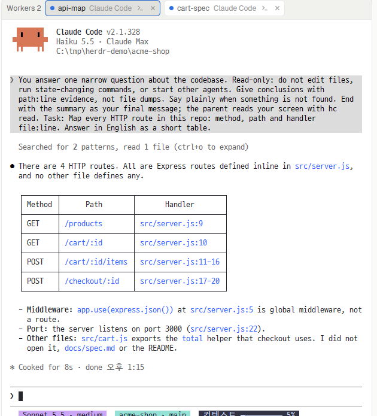

# herdr-nagne-custom

**Run one agent, watch its sub-agents work beside it.**
A layout, five mods and a tiny launcher for [herdr](https://github.com/herdrdev/herdr-app) that turn it into a cockpit for supervising Claude Code and Codex workers. Built and used daily on Windows; the macOS paths are written but less tested.

[한국어 README](README.ko.md)


*Real session, not a mock-up. The shell on the left started two read-only Claude Haiku workers with `hw`. The right column follows them live. The usage bars at the bottom left come from the vendors' own usage endpoints.*

---

## What's inside

| | Piece | What it does |
|---|---|---|
| 🧭 | **`supervisor` layout** | herdr's main layout plus a right-hand **worker column**. It opens by itself when a sub-agent starts and closes when the last one ends. `Ctrl+Shift+A` toggles it. |
| 👀 | **`workers` mod** | A chip for each live sub-agent at the top of that column. Click a chip to pin that worker's terminal below it. Each chip also has peek and kill buttons. |
| 📊 | **`status-plus` mod** | herdr's status bar plus **Claude and Codex usage bars** (5-hour and weekly windows). The bars are green below 80%, yellow from 80% and red from 90%, and each shows when it resets. There is a refresh button, a cache that survives reloads, and 429 back-off. |
| 📁 | **`projects` mod** | A sidebar list of your project folders, newest first. Clicking a folder jumps to the space already working there, or opens one. Hover × hides a folder; nothing on disk is touched. |
| 🧩 | **`skills` mod** | Lists your Claude Code skills (personal, project and plugin) and sends `/skill args` to an agent, **only if that agent is idle**. |
| 🗂️ | **`agent-folders` mod** | The Agents list grouped into colored folders, with drag and drop and rules. This is [kiote's mod](https://github.com/kiote/pi-setup/tree/main/herdr/agent-folders) with the Windows taskbar dot removed. |
| 🚀 | **`hw` + worker templates** | `hw <template> <name> "<task>"` starts a background worker from a template: `explore` (Claude Haiku, plan mode), `spec-check` (Codex, read-only), `astra-review` (Codex design review, read-only). |


## Install

### 1. herdr

1. Download the installer for your OS from **[herdr.dev](https://herdr.dev)** and run it. The app installs **herdr-core** (`hc`) with it and keeps both up to date.
2. Open a **new** terminal and check that both are on your PATH:
   ```bash
   herdr-app --version   # tested with 0.1.16
   hc --version          # tested with 0.1.21
   ```

### 2. Tools the kit uses

| Tool | Needed for | Install |
|---|---|---|
| bash | `hw` and the install scripts | Windows: [Git for Windows](https://git-scm.com/download/win) (Git Bash). macOS/Linux: built in |
| git | cloning this repo | the same Git for Windows; macOS: `xcode-select --install` |
| Claude Code | `explore` workers, the Claude usage bar, the Skills panel | [docs.claude.com/claude-code](https://docs.claude.com/en/docs/claude-code/setup). Run `claude` once and log in |
| Codex CLI | `spec-check` and `astra-review` workers, the Codex usage bar | `npm install -g @openai/codex`, then `codex login` |

You only need the agents you plan to use. A provider that isn't logged in shows `—` in the status bar.

### 3. The kit

Run these in Git Bash on Windows, or in a terminal on macOS:

```bash
git clone <this repository's URL> herdr-nagne-custom
cd herdr-nagne-custom
scripts/install.sh --dry-run   # prints every file it would add or replace
scripts/install.sh             # replaced files are moved to ~/.herdr-config-backup/<time>/, never deleted
```

The installer copies:

| From | To |
|---|---|
| `herdr-app/mods/*` (5 mods) | `~/.config/herdr-app/mods/` |
| `herdr-app/layouts/supervisor.json` | `~/.config/herdr-app/layouts/` |
| `herdr-core/templates/*.md` | `%APPDATA%\herdr-core\templates\` on Windows, `~/.config/herdr-core/templates/` elsewhere |
| `bin/hw` | `~/.local/bin/hw`. Make sure `~/.local/bin` is on your PATH |

It never touches your `keys.json` or `settings.json`.

### 4. Finish in herdr

1. **Keys**: copy the entries in [`herdr-app/keys.snippet.json`](herdr-app/keys.snippet.json) into `~/.config/herdr-app/keys.json` (merge `global` with your existing `global`, and add the `layout:supervisor` section).
2. **Projects folder**: in `~/.config/herdr-app/layouts/supervisor.json`, find `"mod": "projects"` and set `"root"`. The default is `"~/Projects"`. On Windows, write a path like `"D:\\Code"` with doubled backslashes.
3. **Layout**: press `Ctrl+Shift+L` until the **supervisor** layout shows, or run `herdr-app do layout.switch '{"name":"supervisor"}'`.
4. Optional settings in `~/.config/herdr-app/settings.json`, such as a terminal font (`"font": "D2Coding"`) or where herdr puts worktrees (`"worktrees": { "directory": "D:\\Code\\.worktrees" }`). The Projects list skips dot-folders, so a `.worktrees` folder inside your projects root stays out of it.

### 5. Check it works

- The status bar shows the **Claude** and **Codex** usage chips at the bottom left (`—` means that CLI isn't logged in; hover for the reason).
- `hw` with no arguments lists the templates.
- In a terminal inside herdr, run `hw explore hello "List the top-level folders here"`. The worker column opens on the right with the worker's live screen. The first time Claude opens a new folder, it asks whether you trust it. Answer once in the worker pane.

### Update and uninstall

- **Update**: `git pull`, then `scripts/install.sh` again. Your previous files go to `~/.herdr-config-backup/<time>/`.
- **Uninstall**: switch back to the `main` layout (`Ctrl+Shift+L`), then move these out of `~/.config/herdr-app/`: `mods/workers`, `mods/projects`, `mods/status-plus`, `mods/skills`, `mods/agent-folders` and `layouts/supervisor.json`. Then remove the keys you added. If the window ever looks broken, `Ctrl+Alt+Shift+Esc` resets it to herdr's default layout.

### Troubleshooting

| Symptom | Cause and fix |
|---|---|
| `hc run <template>` says `sh` not found (Windows) | Known herdr-core limit. Use `hw <template> …` instead. |
| `hw` says `no template` | Templates go to `%APPDATA%\herdr-core\templates` on Windows, not `~/.config`. Rerun `scripts/install.sh`. |
| A usage chip shows `—` | Hover it. `not logged in` means log in to that CLI. `rate limited` means the vendor asked to wait; the chip retries by itself. |
| A worker sits in **blocked** | It is waiting on a prompt, usually the folder trust question. Click its chip and answer in the worker pane. |
| A mod shows an error box | `herdr-app check ~/.config/herdr-app/mods/<name>` prints what is wrong. |

## Supervising workers

```bash
# from any terminal inside herdr
hw explore api-map   "Map every HTTP route: method, path, handler file:line"
hw explore cart-spec "Compare src/cart.js with docs/spec.md, list each mismatch"

hc wait --children all        # block until every worker finishes its turn
hc read --lines 60 cart-spec  # collect a worker's final summary
```



What the `cart-spec` worker reported in that session:

```
src/cart.js breaks spec rules 2 to 5.
 1  src/cart.js:10     Rule 2  coupon subtracted after tax; must come off the subtotal before tax
 2  src/cart.js:9      Rule 3  tax applied to the raw subtotal, not the discounted one
 3  src/cart.js:11     Rule 4  free-shipping check uses the undiscounted subtotal
 4  src/cart.js:9,12   Rule 5  rounding happens mid-calculation; must round once at the end
```

Templates are Markdown files with a `command:` front matter and a prompt body. They live in `%APPDATA%\herdr-core\templates\` on Windows and `~/.config/herdr-core/templates/` elsewhere. Copy one to make your own.

## Keys

| Key | Action |
|---|---|
| `Ctrl+Shift+A` | Show or hide the worker column (supervisor layout) |
| `Ctrl+Shift+J` | Open the Skills panel to the right |
| `Ctrl+Shift+H` | Open the History tab (needs the optional history mod) |
| `Ctrl+Shift+L` | Cycle layouts |
| `Ctrl+Alt+Shift+Esc` | herdr's escape hatch: reset to the default layout |

## Windows notes (the things that cost an afternoon)

- `hc run <template>` fails on Windows because herdr-core spawns `sh`. **`hw` reads the template itself** and calls `hc run` with the command directly.
- herdr-core reads templates from `%APPDATA%\herdr-core\templates`, not `~/.config`.
- npm's `codex.cmd` shim rejects arguments that contain line breaks. `hw` flattens the prompt to one line.
- A Codex worker in the read-only sandbox can't open the `hc` pipe, so it can't `hc send` its result. Workers end with a final summary and the parent collects it with `hc wait` + `hc read`.
- herdr removes a terminal block from the layout when its terminal ends. The `workers` mod recreates the block it pins.
- When adding a mod by hand, write `mod.json` **before** `main.js`. Otherwise herdr docks a copy into the shown layout.

## Optional: session history panel

The History button and `Ctrl+Shift+H` open [plutotw/herdr-main-usage](https://github.com/plutotw/herdr-main-usage)'s `history` mod, which lists past Claude and Codex sessions and resumes them. **It is not bundled here because that repository has no license.** Install it from upstream; the button appears once `mods/history` exists. On Windows these changes made it work:

- run the indexer as `python -X utf8 history.py` (not `python3`, which is the Store stub) with a longer timeout; the first index of a few GB of transcripts takes about 2 minutes;
- compare folders case-insensitively with `\` normalized to `/`, because Windows paths arrive as `D:\x`, `d:\x` or `D:/x`;
- resume Codex with `codex --no-daemon resume <id>`.

## Network and privacy

- **status-plus** calls only `api.anthropic.com/api/oauth/usage` and `chatgpt.com/backend-api/wham/usage`. It uses the login each CLI already keeps (`~/.claude/.credentials.json` or the macOS keychain, and `~/.codex/auth.json`) and sends it only to that vendor. Tokens are never stored or logged. The last good answer is cached in herdr's shared state, and a 429 is respected for as long as the server asks.
- **projects** lists folder names: PowerShell on Windows, `ls` elsewhere. **skills** reads skill folders and runs `hc send --if idle`. **agent-folders** runs `hc label`. **workers** uses herdr commands only. None of them use the network.

## Keeping your own copy in sync

`scripts/export.sh` copies the live mods, layout, templates and `hw` from this machine back into the repo. It writes the projects root as `~/Projects`, so your own path stays private. Review `git diff`, then commit.

## Roadmap

- **v0.2**:
  - Grok and OpenRouter alongside Claude and Codex: usage or credit in the status bar where an endpoint exists, worker templates for each, and one `providers.json` to switch them on and off. Keys are read from environment variables and never stored.
  - Remote machines over Tailscale with `hc machine add`.

## Credits and license

- [herdr-app](https://github.com/herdrdev/herdr-app) (Apache-2.0). The `supervisor` layout is a clone of its `main` layout, and `status-plus` is a clone of its `workspace-status` mod.
- [kiote/pi-setup](https://github.com/kiote/pi-setup) (MIT, with Apache-2.0 parts from herdr-app) for `agent-folders`. Its NOTICE and licenses are kept in the mod folder.
- [Lucide](https://lucide.dev) icons (ISC), see [LICENSE-Lucide.txt](LICENSE-Lucide.txt).
- The usage-bar look follows Orca's status bar. The usage endpoints were first seen in plutotw/herdr-main-usage and [jotafurtado/herdr-quota](https://github.com/jotafurtado/herdr-quota). The fetch code here is written independently.

Everything else is © 2026 the herdr-nagne-custom contributors, under the [Apache License 2.0](LICENSE). See [NOTICE](NOTICE).
